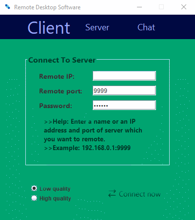
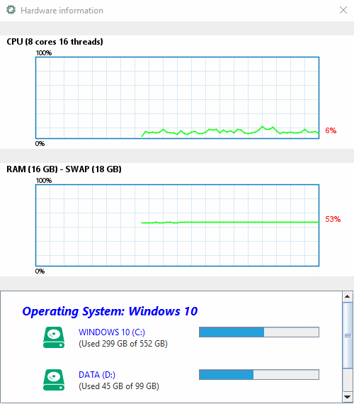
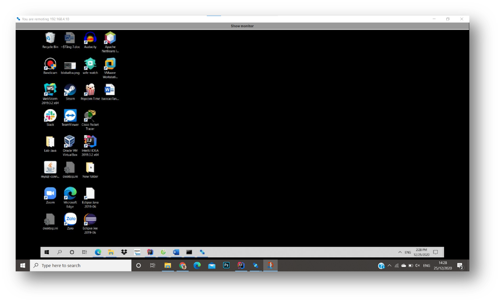

# Remote Desktop

> Written by Chau Truong Long

- Email: truonglongchau@gmail.com

## Overview

Remote Desktop is a Java desktop application for lightweight peer-to-peer remote control and chat.
It allows one machine to host a session and another machine to connect, view the remote screen,
control mouse and keyboard input, exchange chat messages, send files, and inspect hardware
information such as CPU, RAM, and drive usage.

The project is built with classic Java desktop technologies and keeps the architecture intentionally
simple:

- Swing for the desktop GUI
- Java RMI for remote desktop control and hardware queries
- TCP sockets for connection authentication and chat/file transfer
- `Robot` for screen capture and input injection
- `OperatingSystemMXBean` for hardware metrics

## Features

- Remote desktop streaming with mouse and keyboard control
- Client/server connection workflow with password-based authentication
- Live chat between connected peers
- File transfer inside the active session
- Hardware monitor dialog for CPU, RAM, swap, and drive information
- Multiple quality presets for streaming
- Windows executable packaging through Launch4j

## Architecture

The codebase is organized into a few clear areas:

- `src/main/java/com/gui`
  Swing frames, panels, shared UI styles, and reusable UI helpers
- `src/main/java/com/bus`
  Transport and coordination logic for TCP, RMI, and chat messaging
- `src/main/java/com/model`
  Shared serializable data models and enums
- `src/main/java/Application.java`
  Application entry point

At runtime:

1. The server starts a TCP listener and an RMI service.
2. The client authenticates over TCP.
3. Chat and file transfer use the socket connection.
4. Remote desktop frames and hardware info are requested over RMI.

## Recent Improvements

This version includes a more modern Java codebase and several performance-oriented updates:

- Java 26 project target and updated build metadata
- Immutable records and sealed message types in the shared model layer
- Better streaming efficiency through server-side scaling and tuned JPEG compression
- Frame pacing and mouse-event throttling for smoother remote control
- Shared UI helper utilities for background tasks, EDT updates, and error handling
- Safer Swing threading during session cleanup and async UI work

## Requirements

- JDK 26 or newer for the real project build
- Maven 3.9+

## Build And Run

Build the project:

```shell
mvn clean package
```

Run the shaded jar:

```shell
java -jar target/remote-desktop-1.0.0.jar
```

The Maven build is configured to enforce Java 26+.

## How To Use

### Start as server

1. Open the `Server` tab.
2. Choose a local IP address or keep `0.0.0.0`.
3. Enter the listening port and a password.
4. Click `Start listening`.
5. Share the host, port, and password with the remote client.

### Connect as client

1. Open the `Client` tab.
2. Enter the remote host IP or hostname.
3. Enter the port and password from the server.
4. Choose streaming quality.
5. Click `Connect now`.

### During a session

- Use the remote window for desktop control
- Open the hardware monitor from the remote session menu bar
- Use the chat panel to send messages and files

## Project Structure

```text
src/main/java
├── Application.java
├── com/bus
│   ├── chat
│   ├── common
│   ├── rmi
│   └── tcp
├── com/gui
│   ├── chat
│   ├── client
│   ├── common
│   ├── remote
│   └── server
└── com/model
```

## GUI

> ### Main

<p align="center">
    
</p>


> ### Hardware information of server

<p align="center">
    
</p>

> ### Client remote server

<p align="center">
    
</p>

## Notes

- The application is designed for LAN-style direct connections.
- A true Java 26 build requires a local JDK 26 installation.
- If you want to package the Windows executable, use the Maven package phase so the Launch4j
  configuration runs as part of the build.

## Star History

<a href="https://www.star-history.com/?repos=chautruonglong%2FRemote-Desktop&type=timeline&legend=top-left">
 <picture>
   <source media="(prefers-color-scheme: dark)" srcset="https://api.star-history.com/chart?repos=chautruonglong/Remote-Desktop&type=timeline&theme=dark&legend=top-left" />
   <source media="(prefers-color-scheme: light)" srcset="https://api.star-history.com/chart?repos=chautruonglong/Remote-Desktop&type=timeline&legend=top-left" />
   
 </picture>
</a>
